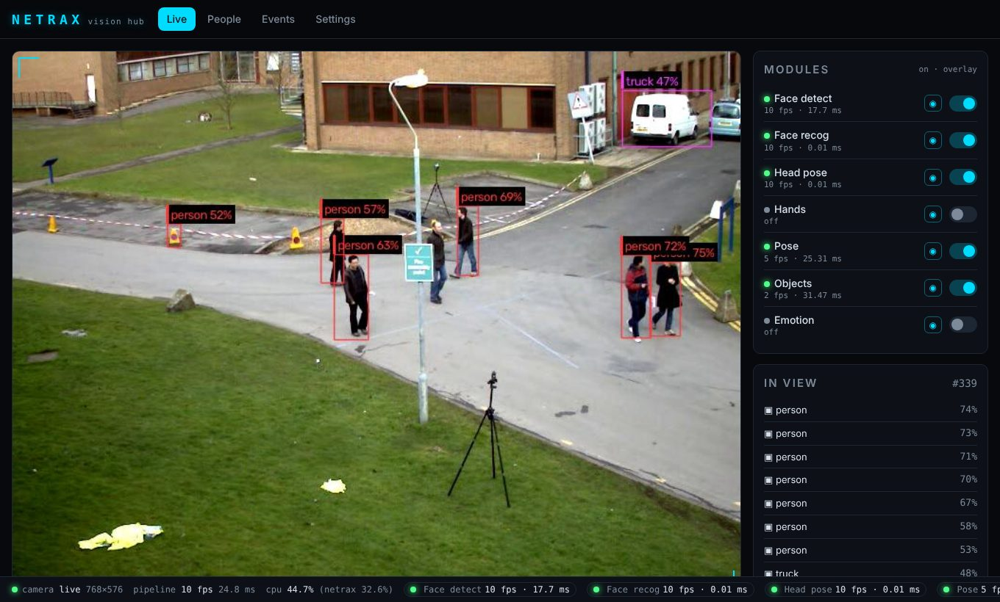
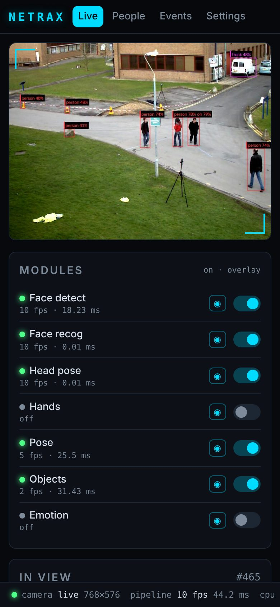
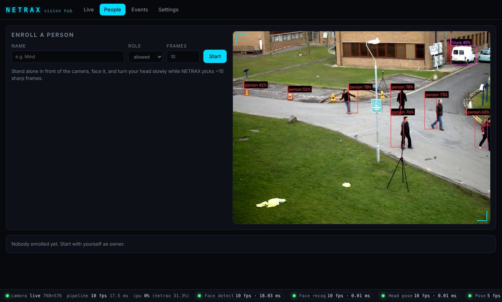
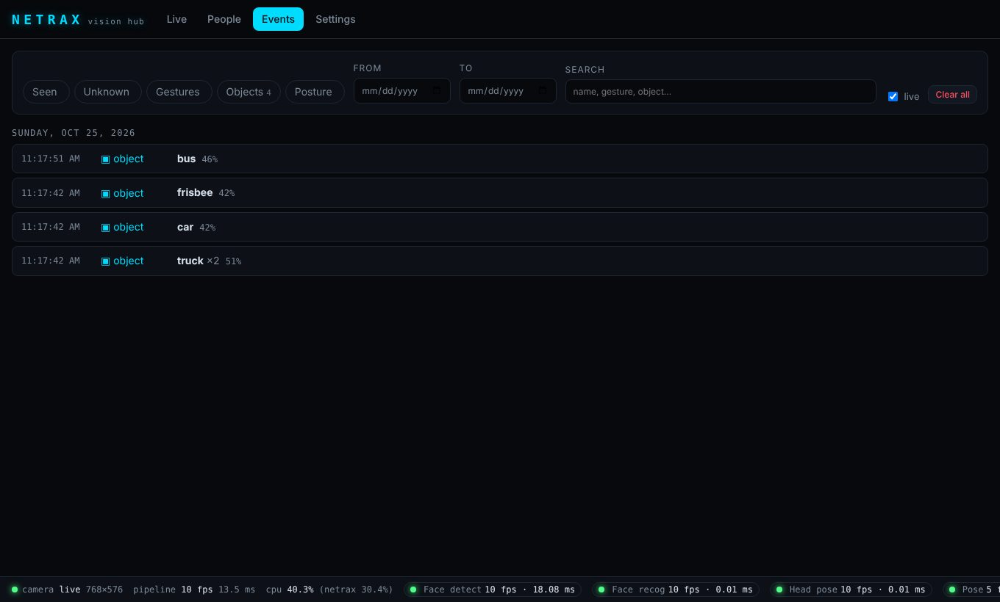
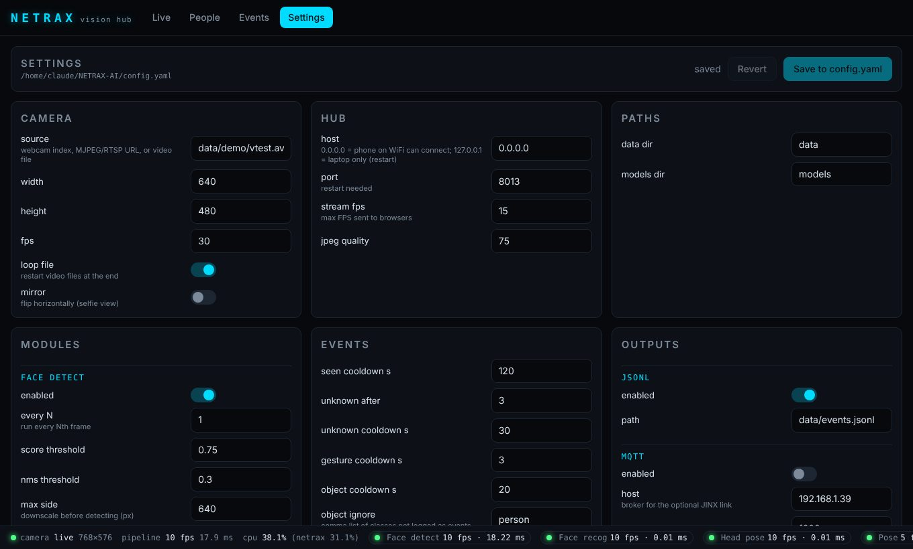

# NETRAX v2

**A standalone, fully local vision hub.** Plug a camera into a laptop, run `netrax hub`, and open a
dashboard (also from your phone) that shows who is in view, gestures, pose, objects and an event timeline.
No cloud, no API keys, no GPU. After the first model download it works offline.

NETRAX was built for my desk robot JINX, but it doesn't depend on it. JINX is just one optional client
that listens over MQTT, and MQTT is **off by default**.

> v2 is a from-scratch rewrite. The v1 code (MediaPipe + Ultralytics) is kept in [`legacy/`](legacy/).

| Live view | Phone |
|---|---|
|  |  |

| People (enroll from the webcam) | Events timeline | Settings |
|---|---|---|
|  |  |  |

## What it does

| Module | What you get | Model |
|---|---|---|
| `face_detect` | face boxes + 5 landmarks, tracked across frames | OpenCV **YuNet** |
| `face_recog` | name, role (`owner` / `allowed` / `unknown`), confidence, verified | OpenCV **SFace** + SQLite people DB |
| `head_pose` | yaw / pitch / roll + "looking left/right/up/down" | `solvePnP` on YuNet landmarks (no extra model) |
| `hands` | 21 hand landmarks; gestures: open palm, fist, thumbs up, point, peace | MediaPipe palm + hand landmarks (ONNX) |
| `pose` | 17 COCO keypoints, posture (upright / slouching / leaning), "dance skeleton" style | MediaPipe person detector + BlazePose (ONNX) |
| `objects` | COCO 80-class boxes, run at a lower rate | **NanoDet-Plus** (default) or YOLOX-S |
| `emotion` *(optional)* | 7 expressions | MobileFaceNet FER (ONNX) |

Each module is a plugin (`netrax/detectors/*.py`) with the same interface: `load()`,
`process(frame) -> list[Result]`, `draw(frame, results)`. You can switch each one on or off live
from the dashboard or in `config.yaml`, and heavy ones run every N frames.

## Install (EndeavourOS / Arch, global Python, no venv)

```bash
# 1. system packages (Python 3.14 builds from the Arch repos)
sudo pacman -S --needed python python-pip python-numpy python-yaml python-pydantic \
    python-psutil python-fastapi uvicorn python-paho-mqtt python-pytest python-httpx

# 2. OpenCV 5 from PyPI (Arch's python-opencv is a different build; NETRAX needs 5.x)
pip install --break-system-packages "opencv-python>=5"

# 3. NETRAX itself (editable, so `git pull` updates it)
git clone https://github.com/Sidvortex/NETRAX-AI.git && cd NETRAX-AI && git checkout v2
pip install --break-system-packages -e .

# 4. camera access (log out and back in afterwards)
sudo usermod -aG video $USER
```

If pacman can't find one of those packages, `pip install --break-system-packages <name>` works too.
Every dependency has a Python 3.14 wheel: OpenCV 5 ships one `abi3` wheel for all CPython ≥ 3.7, and
the rest are pure Python or have `cp314` wheels. **MediaPipe isn't used.** Its models run as ONNX through
OpenCV, so there's no TensorFlow/MediaPipe runtime to install.

> OpenCV 5 removed Haar cascades. NETRAX only uses DNN/ONNX models, and YuNet is the
> `2026may` export with dynamic input sizes that OpenCV 5's new DNN engine needs.

## Quick start

```bash
netrax doctor                          # checks Python, OpenCV 5, models, camera, DB, port
netrax models --download               # optional: fetch models for the enabled modules now
netrax hub                             # camera + dashboard
```

Open **http://localhost:8000**. `netrax hub` also prints a `http://192.168.x.x:8000` link you can open
on a phone or tablet on the same WiFi.

Enroll yourself (in the dashboard's **People** page, or from the terminal):

```bash
netrax enroll --name Mind --role owner        # look at the camera, turn your head slowly
netrax enroll --name Mind --from-dir ~/Pictures/me    # or from photos
netrax people                                  # list; --rename A B, --role A allowed, --delete A
```

Check the speed on your machine:

```bash
netrax bench                     # face_detect + face_recog, must be >= 12 FPS
netrax bench --every-frame       # worst case: recognise every face on every frame
netrax bench --all               # every module
```

Run without the dashboard:

```bash
netrax run                       # OpenCV window, q to quit
netrax run --no-window           # headless, one status line per second
netrax run --no-window --json    # one JSON line per processed frame (pipe it anywhere)
```

Any command takes `--source` for a one-off camera override (it isn't saved): a webcam index (`0`, `1`),
an MJPEG/RTSP URL (`http://192.168.1.50:81/stream`, `rtsp://...`), or a video file.

## Performance

`netrax bench` on a 2-core cloud Xeon VM (no GPU), 640×480, 5 faces in view:

| run | pipeline FPS |
|---|---|
| face_detect + face_recog (default: recognise once per track, recheck every 15 frames) | ~53 |
| same, worst case `--every-frame` (all 5 faces recognised every frame) | ~14 |
| every module on (`--all`) | ~17 |

Per module on that machine: YuNet ~12 ms, SFace ~11 ms per face, hands ~12 ms, pose ~43 ms,
NanoDet ~28 ms, emotion ~5 ms per face. Your laptop's numbers come from `netrax bench`.

Why it's fast: faces are **tracked**, so SFace runs on a new face a few times and then only every
`recheck_every` frames, and the identity is a majority vote. Heavy modules run every N frames with
staggered phases, so they don't all land on the same frame.

## Dashboard

- **Live**: annotated MJPEG video, a per-module on/off switch and overlay toggle, and what's in view right now.
- **People**: enroll from the webcam (NETRAX keeps ~10 sharp, frontal, varied frames and gives live
  hints like "come closer" or "hold still"), set role, rename, delete, see and remove photos, add more photos.
- **Events**: timeline of who was seen, unknown faces (with snapshot), gestures, objects and posture.
  You can filter by type, date range and text.
- **Settings**: every option in `config.yaml`, validated and saved to disk, applied live
  (host/port need a restart). It also has the model and license table.
- **Status bar** on every page: camera state, pipeline FPS, CPU %, and FPS/ms per module.

## Configuration

Everything tunable is in `config.yaml` next to where you run NETRAX (or `--config path`,
or `$NETRAX_CONFIG`). You only write the keys you change. All defaults, with comments, are in
[`netrax/config.default.yaml`](netrax/config.default.yaml). Typos are rejected at startup.

```yaml
camera:
  source: 0                 # or "http://esp32-cam.local:81/stream", "rtsp://...", "clip.mp4"
modules:
  face_recog:
    threshold: 0.363        # cosine similarity for a match (SFace's standard value)
  hands:   { enabled: true }
  pose:    { enabled: true, style: dance }
  objects: { enabled: true, model: nanodet, every_n: 5, classes: [cup, cell phone, laptop] }
events:
  seen_cooldown_s: 120      # log "seen Mind" at most every 2 minutes
outputs:
  mqtt: { enabled: true }   # the JINX link
```

| Section | Main keys |
|---|---|
| `camera` | `source`, `width`, `height`, `fps`, `mirror`, `loop_file` |
| `hub` | `host` (`0.0.0.0` = LAN, `127.0.0.1` = this laptop only), `port`, `stream_fps`, `jpeg_quality` |
| `modules.<name>` | `enabled`, `every_n`, plus per-module thresholds |
| `events` | cooldowns, `unknown_after`, `object_ignore`, `snapshot_seen`, `keep_days` |
| `outputs` | `jsonl` (every event to `data/events.jsonl`), `mqtt` |

Head pose angles are from the camera's point of view: `yaw > 0` = face turned towards the image's
right, `pitch > 0` = up, `roll > 0` = tilted clockwise. Posture calibrates itself: it learns your
upright head height over the first seconds and calls it slouching when your head drops `slouch_drop`
(20%) below that.

## Optional JINX link (MQTT)

Off by default. With `outputs.mqtt.enabled: true` NETRAX connects anonymously to
`192.168.1.39:1883` (change `host`/`port`). It keeps working and retrying if the broker is down.

| Topic | Payload | When |
|---|---|---|
| `jinx/head_track` | `"x,y,d"`, e.g. `0.512,0.430,1`: face centre normalised 0–1, `d=1` if a face is seen | ≤ 12 Hz (`head_track_hz`); `x,y,0` once a second when nobody is there |
| `netrax/identity` | `{"name","role","verified","confidence","track_id","person_id","ts"}` (`name: null` when nobody) | on change, retained |
| `netrax/faces` | `{"ts","size":[w,h],"faces":[{bbox,score,landmarks,track_id,name,role,confidence,verified,yaw,pitch,roll,direction,emotion}]}` | ≤ `rate_hz` (5) |
| `netrax/pose` | `{"ts","poses":[{bbox,keypoints[17×(x,y,vis)],score,posture,metrics}]}` | ≤ `rate_hz` |
| `netrax/gesture` | `{"gesture","hand","confidence","ts"}` | each gesture event |
| `netrax/objects` | `{"ts","objects":[{bbox,label,class_id,score}]}` | when objects run, ≤ `rate_hz` |
| `netrax/status` | `{"online","fps","cpu","camera","modules"}`; last will `{"online": false}` | every 5 s, retained |

The face JINX should look at is the verified owner if present, else any verified person, else the
largest face. Watch the traffic with:

```bash
sudo pacman -S mosquitto
mosquitto_sub -h 192.168.1.39 -t 'jinx/#' -t 'netrax/#' -v
```

## Models and licenses

All models are permissively licensed and come from [OpenCV Zoo](https://github.com/opencv/opencv_zoo),
pinned to one commit. They download on first use into `models/`, and every file is checked for exact
size and SHA-256. They're stored with Git LFS, so NETRAX downloads from `media.githubusercontent.com`:
`github.com/.../raw/...` returns a tiny LFS pointer, and NETRAX detects and rejects that.

| Model | File | Size | License | Used by |
|---|---|---|---|---|
| YuNet | `face_detection_yunet_2026may.onnx` | 0.2 MB | MIT | face_detect |
| SFace | `face_recognition_sface_2021dec.onnx` | 38.7 MB | Apache-2.0 | face_recog |
| MediaPipe palm detector | `palm_detection_mediapipe_2023feb.onnx` | 3.9 MB | Apache-2.0 | hands |
| MediaPipe hand landmarks | `handpose_estimation_mediapipe_2023feb.onnx` | 4.1 MB | Apache-2.0 | hands |
| MediaPipe person detector | `person_detection_mediapipe_2023mar.onnx` | 12.0 MB | Apache-2.0 | pose |
| BlazePose landmarks | `pose_estimation_mediapipe_2023mar.onnx` | 5.6 MB | Apache-2.0 | pose |
| NanoDet-Plus 416 | `object_detection_nanodet_2022nov.onnx` | 3.8 MB | Apache-2.0 | objects (default) |
| YOLOX-S 640 | `object_detection_yolox_2022nov.onnx` | 35.9 MB | Apache-2.0 | objects (`model: yolox`) |
| MobileFaceNet FER | `facial_expression_recognition_mobilefacenet_2022july.onnx` | 4.8 MB | Apache-2.0 | emotion |

> ⚠ **Ultralytics YOLO (v5/v8/v11) is AGPL-3.0.** Using it would put the whole project under AGPL's
> network copyleft, so v2 doesn't use it. NanoDet-Plus and YOLOX are Apache-2.0.

Some pre/post-processing code is adapted from OpenCV Zoo (Apache-2.0); see [`NOTICE`](NOTICE).

## Privacy

Faces, enrollment photos, unknown-face snapshots, the SQLite DB (`data/netrax.db`) and the event log
all live in `data/`. That folder is git-ignored and nothing is ever uploaded. Events older than
`events.keep_days` (30) are deleted together with their snapshots.

The dashboard has no login. With `hub.host: 0.0.0.0`, anyone on your WiFi can open it, so set
`127.0.0.1` on networks you don't trust.

## Project layout

```
netrax/
  cli.py              netrax hub | run | enroll | people | bench | doctor | models
  config.py           pydantic schema + config.default.yaml
  models.py           model registry, downloader (size + SHA-256 + LFS-pointer check)
  runtime.py          wires engine, DB, events and outputs together
  core/               source (webcam/URL/file), pipeline, scheduler, tracker, engine, events, enroll
  detectors/          one file per module: face_detect, face_recog, head_pose, hands, pose, objects, emotion
  db/                 SQLite store + numbered SQL migrations
  hub/                FastAPI app + routers + static/ dashboard (plain HTML/JS/CSS, no build step)
  outputs/            jsonl.py, mqtt.py
tests/                pytest: config, DB, pipeline, API, events, enroll, gestures, head pose, MQTT, ...
legacy/               v1
```

## Development

```bash
python -m pytest -q                      # ~80 tests, a couple of seconds, no camera needed
```

Adding a module: create `netrax/detectors/<name>.py` with a `Detector` subclass, register it in
`netrax/detectors/__init__.py`, and add a `<name>:` section to the config schema.

## Troubleshooting

- **`camera 0 gave no frame`**: another app (or another `netrax hub`) has the camera. Run `ls /dev/video*`,
  check you're in the `video` group, or try `--source 1`.
- **`OpenCV 4.x is too old`**: pacman's `python-opencv` is shadowing pip's. Run
  `pip install --break-system-packages -U "opencv-python>=5"` (or remove `python-opencv`).
- **No window in `netrax run`**: you have `opencv-python-headless`. Use the hub or `--no-window`.
- **A model download fails**: you're offline or behind a proxy. Copy the `.onnx` files into `models/`.
  `netrax models` shows what's missing.
- **Wrong person recognised**: add more photos (People → Add photos) in different lighting, or raise
  `modules.face_recog.threshold` a little (e.g. 0.40).
